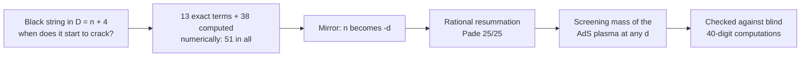

# When a black string cracks: the Gregory-Laflamme threshold to order 1/n^12

**We pushed the exact recipe for when a stretched black hole starts to break apart from five terms to thirteen. The list
itself appears to run away, yet those 13 exact terms plus 38 computed numerically (51 in all), summed the right way and
read through a mathematical mirror, predicted how a hot plasma screens a disturbance to about 15 digits, at a dimension
it had never seen.**

Moki & Julio

[](https://doi.org/10.5281/zenodo.23940227)


**Read** [paper.md](paper.md) · **Re-run** [REPRODUCE.md](REPRODUCE.md) (Python + mpmath, seconds) · **Check**
[SEALS/HASHES.md](SEALS/HASHES.md) · **Companion** [Paper II](https://github.com/Hashirama1337s/airy-edge-hydrodynamics)

## The story in a minute

Many black-hole questions are hard to solve exactly in our four dimensions. They become simple when the number of
dimensions is very large. The price is that every answer comes as an endless list of corrections, one per power of 1/D.

A **black string** is a black hole stretched along an extra dimension. If it is long enough, it is unstable and starts to
break up. A picture that helps (it is only a picture): a thin stream of water from a tap, which beads into drops once it is
long enough. Where the picture breaks: there is no water and no surface tension here, only the geometry of space and time,
and we compute only the point where the trouble *starts*, not what happens after.

That starting point is one number, the **Gregory-Laflamme threshold**. Five terms of its list were published in 2015 and
2018. We now have thirteen in all, derived by exact algebra and checked against numbers computed separately. The terms are
built from famous constants, the zeta values (for example zeta(3) = 1 + 1/8 + 1/27 + 1/64 + ...), including rarer
"multiple" zeta values such as zeta(5,3) and zeta(3,5,3).

The surprise came next. The list grows so fast that adding terms eventually makes things worse: there is strong numerical
evidence that it never converges. But a standard change of variables turns the same list into a statement about a hot
plasma of the kind studied with holography (a way of modelling a hot plasma with a black hole in one extra dimension).
Summed with a standard rational method, the 13 exact terms plus 38 computed numerically (51 in all) predicted that
plasma's screening mass (how strongly it damps a still disturbance) to about 9 digits at d = 3.25 and about 15 digits at
d = 6.5, two dimensions it had not been tuned on. The same method does not work in the other direction, for the black
string itself in low dimensions.

Why "d = 3.25"? The formulas can be evaluated at any d, whole or not. A non-integer d is a mathematical test point, not a
real space, and that makes it a fair exam: nothing had been tuned there.

Every scored prediction was written down and hashed before a separate, blind seat computed the answer, except where the
scorecards flag otherwise. Failures are listed as failures.

## Climb the ladder

### Step 1 - the idea (for anyone)

One list of numbers, two uses. Read directly, it describes a black string in D = n + 4 dimensions. Replace n by -d (the
"mirror", known as the AdS/Ricci-flat map), and it describes a black brane in anti-de Sitter space with d boundary
dimensions: the holographic plasma.



Where the mirror analogy breaks: the two sides have different boundary conditions. The dictionary was checked on the
list of terms (to order n^-4 in 2015, and here numerically, term by term, for orders 3 to 8), which does not make it
automatic for everything you build from it. It worked towards the plasma side; it did not work back on the black-string
side at low dimension.

### Step 2 - how it works (for a curious student)

The threshold wavenumber times the horizon radius is written k_GL r0 = sqrt(n) (k0 + k1/n + k2/n^2 + ...). Its square is
lambda(n) = (k_GL r0)^2, and lambda(n)/n = g0 + g1/n + g2/n^2 + ... is the form we resum. The first k terms are 1, -1/2
and 7/8. Then zeta
values appear: k3 = 2 zeta(3) - 25/16, and k5 = -1335/256 + (47/4) zeta(3) - 38 zeta(5) = -30.4939... Further out the terms
grow fast:

| term | value |
|---|---|
| k5 | -30.49392983... |
| k8 | 7040.44135112... |
| k10 | -458974.765607... |
| k11 | -3969169.08716... |
| k12 | 1249860.14616... |

You can watch the runaway happen. At D = 6, the sum through the 1/n^4 term is off by 2.4 %; adding the next term makes it
off by 110 %. Measured another way, the size of the j-th coefficient g_j, taken to the power 1/j, rises from 3.3 at
j = 8 to 11.2 at j = 40.

So instead of adding terms one by one, we fit a **fraction**, a ratio of two polynomials of degree 25 (a Pade approximant),
that agrees with the list g0..g50: the 13 exact terms plus 38 computed numerically from high-precision solutions
(51 in all). Evaluated at n = -d it gives the plasma's screening mass m^2(d). At d = 6.5 the sealed
prediction was m^2 = 7.785729384100830426657530533626601859545; a blind seat then computed the true value, and the
relative error was 1.17e-15. As a control at d = 4 (a training point, so not a test) the series agrees with the five
published digits, m = 2.3361 pi T, and with a 40-digit computation to 2e-11.

### Step 3 - the real thing (for specialists)

- **Series.** The static threshold lambda(n) = (k_GL r0)^2 in D = n + 4 is derived analytically in closed form through
  n^-12 within the standard large-D matched-asymptotic framework. zeta(5,3) enters at order 8; at order 11 an irreducible
  depth-three value (zeta(3,5,3) in our basis). The derived k11, k12 reproduced numerics sealed first to 2.5e-64 and 1.9e-59.
- **Large-order law.** A law fitted on coefficients through g40 predicted g41..g50 within 0.3 % (bar 3 %; 5 % at j = 44, 48).
- **Resummation.** Continued to n = -d, plain Pade [25/25] gives the static sound-channel screening mass of the AdS_{d+1}
  black brane with blind relative error 1.2e-15 at fresh d = 6.5 and 5.8e-10 at fresh d = 3.25; a first, pole-subtracted
  test gave 2.2e-10, 2.9e-12 and 7.4e-14 at fresh d = 3.5, 4.5, 5.5.
- **Tension.** Any term the resummation misses on the AdS side is below 2e-11 at d = 4 (a training point) and 3e-12 at
  fresh d = 4.5, a tension with the heuristic extension to AdS of the expected non-perturbative corrections.

Full wording, prior art and disclosures: [paper.md](paper.md) (Appendix B lists every protocol slip). The scorecard:


## Use it as a tool

Questions this lets you answer:

- What is the static screening mass of the AdS_{d+1} black brane at a non-integer d, say 3.25 or 6.5?
- What are k0..k12 and g0..g12 to 450 digits, or the closed forms of k3..k12?
- Do the sealed predictions, verdicts and hashes check out?

**Re-run the headline numbers** (Python 3 and mpmath, nothing else; run from the top folder). `-c core.autocrlf=false`
keeps the files byte for byte as committed; on Windows a default clone converts line endings and every line of the hash
check then fails.

```
git clone -c core.autocrlf=false https://github.com/Hashirama1337s/large-d-gregory-laflamme
cd large-d-gregory-laflamme
mkdir out
python code/exact.py 450
python code/predict_F2.py
python code/verdict_F2.py
python code/verdict_F1.py
sha256sum -c MANIFEST.sha256
```

`code/verdict_F2.py` should end with

```
P1 d=2.25 HOLDS rel25 2.2e-7 rel23 5.36e-7 3*bar 1.78e-5
P2 d=3.25 HOLDS rel25 5.84e-10 rel23 2.52e-9 3*bar 3.03e-8
P3 d=6.5 HOLDS rel25 1.17e-15 rel23 4.18e-14 3*bar 9.48e-13
P4 d=13.3 HOLDS rel25 2.6e-23 rel23 1.43e-21 3*bar 6.3e-20
P5 HOLDS
```

Every expected output is listed in [REPRODUCE.md](REPRODUCE.md). `MANIFEST.sha256` on the main branch covers the files
as they are now, including this README. To check the archived release (the Zenodo v1.0 deposit) instead, run
`git checkout v1.0` right after `cd`, then the same commands.

**Reuse the resummation at your own d.** This is the recipe of `code/predict_F2.py`, trimmed to a function (run it from
the top folder):

```python
import json, mpmath as mp
mp.mp.dps = 80
E = json.load(open('data/exact_g.json'))['g']        # exact g0..g12
N = json.load(open('data/np_RESULT.json'))['g']      # fitted g13..g50
g = [mp.mpf(E[j]) for j in range(13)] + [mp.mpf(N[str(j)]) for j in range(13, 51)]
p, q = mp.pade(g[:51], 25, 25)

def m2(d):
    """Pade [25/25] screening mass m^2(d) of the AdS_{d+1} black brane (units r0 = L_AdS = 1)."""
    d = mp.mpf(d); x = -1 / d
    return d * mp.polyval(p[::-1], x) / mp.polyval(q[::-1], x)

print(mp.nstr(m2('6.5'), 20))   # 7.7857293841008304267, the sealed BAR-F2 prediction
```

Compare `m2(4)` with the published 5.457 and `m2(6)` with 7.308. The tests cover 2.25 <= d <= 13.3; outside that range
the function is untested, and it does not work for the black string itself (positive n) at low dimension.

## What we did not show

- No remainder bounds on any closed form; the far zone is treated as beyond all orders (the standard assumption). The
  internal referee covered the derivation through n^-10; k11 and k12 rest on the derivation seat plus the sealed numerics.
- Divergence of the series is strong numerical evidence, not a proof.
- No resummation reached D = 5 to the sealed accuracy, and the same Pade pipeline misses the black-string threshold at
  n = 3 and 5 by 62 % and 99 %. Several sealed tests FAILED (BAR-NP P3, BAR-R1 P3-P4, BAR-SB P1-P3), including a
  proposed bridge through negative d.
- No proof that the resummation converges; the error falls overall with Pade order, not monotonically.
- The F2 target values come from F1's master equation, cross-checked by separately written code but not by an independent
  equation.
- The large-order law rests on one sealed prediction set (g41..g50) and one sealed exponent fit, with no sealed null
  extrapolation beside them.
- The internal referee is a separately briefed seat of the same lab, not external peer review. Disclosed slips are in
  Appendix B of the paper; none changed a verdict.

## Words you will meet

- **Black string** - a black hole stretched along an extra dimension; uniform ones are unstable when long enough.
- **Gregory-Laflamme threshold** - the wavelength at which that instability starts.
- **Large-D (1/n) expansion** - solving in very many dimensions and correcting term by term; here D = n + 4.
- **Multiple zeta value** - a nested sum such as zeta(5,3) = sum over a > b >= 1 of a^-5 b^-3.
- **Divergent (asymptotic) series** - a list whose partial sums first improve, then run away.
- **Pade approximant** - a fraction of two polynomials chosen to match a series; it can make sense where the plain sum
  does not.
- **AdS black brane / holography** - a black hole with a flat (planar) horizon in anti-de Sitter space, used as a model
  of a hot plasma.
- **Screening mass** - how quickly the plasma damps a static disturbance with distance.
- **Sealed test / blind seat** - predictions hashed before the answer exists; the answer computed by a separate seat that
  cannot see them.
- **Zeta value** - zeta(s) = 1 + 1/2^s + 1/3^s + ...; for example zeta(3) = 1 + 1/8 + 1/27 + ...
- **Fresh point** - a dimension d the predictor was never tuned on.

---

## For specialists: the original README

# The Gregory-Laflamme threshold to order 1/n^12 and its resummation to AdS screening masses

Moki & Julio

[](https://doi.org/10.5281/zenodo.23940227)


**At a glance.** The exact large-dimension series for the point where a black string cracks (the Gregory-Laflamme
threshold), taken from order 1/n^4 to 1/n^12; its terms are multiple zeta values, including zeta(5,3) and zeta(3,5,3).
The same series, continued to negative dimension, predicts the screening masses of the AdS black brane (1.2e-15 at the
fresh point d = 6.5). Every test was sealed before the data except where flagged, and failures are shown.

**Read** [paper.md](paper.md) · **Re-run** [REPRODUCE.md](REPRODUCE.md) (Python + mpmath, seconds) · **Check** [SEALS/HASHES.md](SEALS/HASHES.md) · **Companion** [Paper II](https://github.com/Hashirama1337s/airy-edge-hydrodynamics)


This repository holds the preprint (paper.md), the data, the code that regenerates the headline numbers, and the
sealed-test records for Paper I. Archived at Zenodo: [doi:10.5281/zenodo.23940227](https://doi.org/10.5281/zenodo.23940227) (all versions; v1.0 = 10.5281/zenodo.23940228). Repository: https://github.com/Hashirama1337s/large-d-gregory-laflamme

- paper.md: the preprint.
- data/: closed forms of k3..k12 with decimals, k0..k12 and g0..g12 to 450 digits, g13..g50, the sealed predictions and blind
  AdS screening masses of the two finite-d tests, and the Pade-order convergence table.
- code/: k-series evaluation, the plain-Pade prediction (BAR-F2), and the scorers of BAR-F1 and BAR-F2.
- SEALS/: prediction files, scorers, verdicts and seal hashes of every sealed test in the paper (see SEALS/HASHES.md).
- REPRODUCE.md: commands and expected outputs. MANIFEST.sha256: hashes of all files.

## In plain words

Black holes are hard to solve exactly in our four dimensions, but they become simple when the number of dimensions is
very large. The price is that every answer comes as an endless list of corrections, one per power of 1/D. We asked two
questions of one such list.

First, a long black string (a black hole stretched along an extra dimension) breaks up if it is long enough. The
wavelength at which this starts is one number. We computed its list of corrections far beyond the five terms published
in 2015 and 2018: thirteen terms in all, derived by exact algebra and checked against numbers computed separately. The
terms are built from the famous zeta values, including rarer "multiple" zeta values. There is strong numerical evidence that
the list does not converge, and we measured how fast it blows up.

Second, a standard change of variables turns the same list into a statement about a hot plasma of the kind studied with
holography (a black brane in anti-de Sitter space). Summed with a standard rational method, our black-string list
predicted how fast that plasma screens a static disturbance, including at dimensions where nobody had computed it. At the
two fresh dimensions of the final test it was right to about 9 digits (d = 3.25) and about 15 digits (d = 6.5). The same
method does not work in the other direction, for the black string itself in low dimensions.

Every scored prediction was written down and hashed before the answer was computed by a separate, blind seat, except where
the scorecards below flag otherwise. Some predictions failed; they are listed as failures.

## Scorecard

HOLDS means the prediction passed the bar written before the data; FAILED and VOID are reported as such. Realised errors are
relative unless stated.

### The series and its large-order law

| Test | Prediction (short) | Verdict | Realised numbers / disclosure |
|---|---|---|---|
| BAR-K5 C1, C2 | blind g3, g4; lambda(n = 1) vs seat C | HOLD | 2.9e-78, 5.6e-75; 5.3e-31 |
| BAR-K5 P1 | blind k5 = closed form to 1e-30 | HOLDS | 1.6e-71 (fit vs formula; implementations agree ~1e-57) |
| BAR-K5 P2, P3 | blind k6 vs seat C; lambda(n = 27), lambda(n = 47) | HOLD | 9.0e-61; 7.4e-17, 8.1e-17 (n = 47 comparator unsealed) |
| BAR-K5 N1, N2 | -37 zeta(5) variant misses; no relation without zeta(5) | HOLD | misses by 0.034; none |
| BAR-K8 C1, P1, P2, N1 | stuffle; k7 formula on new 160-digit data; k8 vs seat B | HOLD | 2.3e-131; 7.6e-92; 1.9e-74 |
| BAR-K8 P3-P5 | order-8 log structure on a 12-element basis | VOID | 84 trusted digits too few; spurious relation rejected |
| BAR-DERIV C1a, C1b, P1, P2 | derivation reproduces k3, k4; equals identified k5, k6 | HOLD | term by term, difference 0 |
| BAR-K11 P1, P2, C1 | derived k11, k12 vs sealed numerics | HOLD | 2.5e-64 (bar 1e-55), 1.9e-59 (bar 1e-50); seal-hash file written after the result |
| BAR-R2 P1-P4 | rational part, zeta(3), zeta(5) towers, no lone zeta(2), to order 30 | HOLD to j = 22; VOID j = 23-30 | exact rational equality |
| BAR-NP P1, P2 | g41..g50 within 3% (5% at j = 44, 48); exponents | HOLD | within 0.3%; a = 0.5019, Im s = 1.5716; no sealed null extrapolation |
| BAR-NP P3 | law-subtracted Borel: lambda(1) < 0.5%, lambda(2) < 1e-4 | FAILED | 1.2-8.3%; 3.1e-4-1.9e-3 |
| BAR-NP N1 | no-phase null | NOT EVALUABLE | pole on the integration ray |
| BAR-R1 P1, P2 | derived K in [0.2615, 0.2635]; a, s | HOLD | 0.2624038 (target window visible to the seat) |
| BAR-R1 P3, P4 | lambda(1) to 1e-7; lambda(2) to 1e-8 | FAILED | 7.7e-6; 1.75e-7 (error bars covering the true values) |

### The resummation to AdS screening masses

| Test | Prediction (short) | Verdict | Realised numbers / disclosure |
|---|---|---|---|
| BAR-ADS P0, P1 | static screening mode exists; c = 1 | HOLD | leading form supplied by the brief |
| BAR-ADS P2 | a1 = a2 = 0; a3..a8 = (-1)^j L_j | HOLDS | 6.8e-66 .. 2.9e-47 |
| BAR-F1 P1-P7 | seven d within 3 x ensemble bar | HOLD | 4.6e-8 .. 2.9e-19 (fresh: 3.5, 4.5, 5.5) |
| BAR-F1 P8 | d = 4.5 < 1e-9 and d = 7 < 1e-13 | HOLDS | 2.9e-12; 6.4e-16 |
| BAR-F1 N1 | flat side misses by > 10% | HOLDS (cannot fail; not a test) | 62%, 99% |
| BAR-SB P1, P2, P3 | residue signs, sizes; bridge gaps | FAILED | d = -12 no pole; -16 off 10%; gap 16.4 off 21% |
| BAR-SB P4 | no poles at d = -21, -25 | HOLDS | < 3e-27 |
| BAR-F2 P1-P4 | four new d within 3 x bar | HOLD | 2.2e-7 .. 2.6e-23 (fresh: 3.25, 6.5); margins 20x, 11x, 104x, 170x; refereed internally |
| BAR-F2 P5 | [25/25] beats [23/23] at every d | HOLDS | all four d; [23/23] is a local bump (worse than [20/20], [22/22]) |

The disclosures behind each row (scorers or harnesses written after data, a seal-hash file written after the result, seal
files edited after sealing, a brief that supplied a leading form, a seat that saw its target window) are in Appendix B of the
paper.

*Prepared with AI assistance; all results are machine-checked.*
