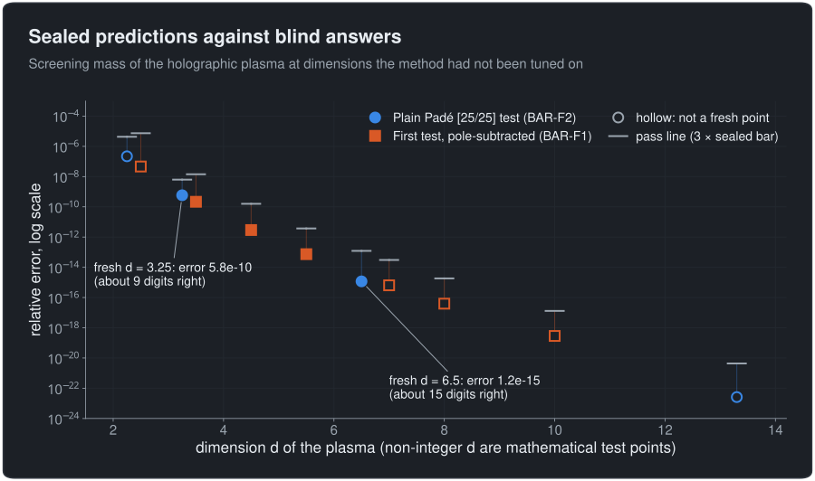
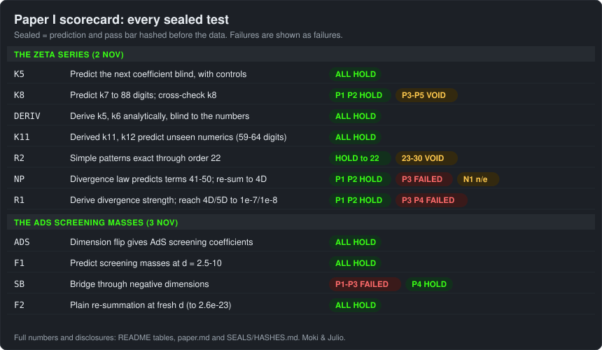
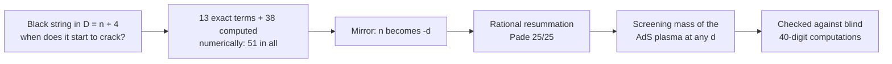
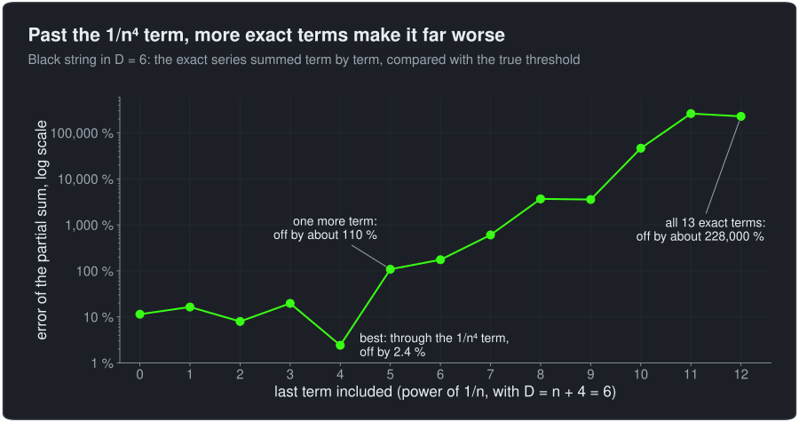

# When a black string cracks: the Gregory-Laflamme threshold to order 1/n^12

**The exact large-dimension recipe for when a black string starts to break apart, pushed from five terms to thirteen; with 38 numerical terms and a standard resummation it predicted a hot plasma's screening mass to 9 and 15 digits at two untuned dimensions.**

[](https://doi.org/10.5281/zenodo.23940227)  [](https://github.com/Hashirama1337s)

Moki & Julio · 2026 · version 1.0.1

**Read** [paper.md](paper.md) · **Re-run** [REPRODUCE.md](REPRODUCE.md) (Python + mpmath, seconds) · **Check**
[SEALS/HASHES.md](SEALS/HASHES.md) · **Companion** [Paper II](https://github.com/Hashirama1337s/airy-edge-hydrodynamics)

## In plain words

Many black-hole questions are hard to solve exactly in our four dimensions. They become simple when the number of
dimensions is very large. The price is that every answer comes as an endless list of corrections, one per power of 1/D.

A **black string** is a black hole stretched along an extra dimension. If it is long enough, it is unstable and starts to
break up.

 **The idea in one picture.** A thin stream of water from a tap, which beads into drops once it is
long enough. **Where the picture breaks.** There is no water and no surface tension here, only the geometry of space and time,
and we compute only the point where the trouble *starts*, not what happens after.

That starting point is one number, the **Gregory-Laflamme threshold**. Five terms of its list were published in 2015 and
2018. We now have thirteen in all, derived by exact algebra and checked against numbers computed separately. The terms are
built from famous constants, the zeta values (for example zeta(3) = 1 + 1/8 + 1/27 + 1/64 + ...), including rarer
"multiple" zeta values such as zeta(5,3) and zeta(3,5,3).

The surprise came next. The list grows so fast that adding terms eventually makes things worse: there is strong numerical
evidence that it never converges. But a standard change of variables turns the same list into a statement about a hot
plasma of the kind studied with holography (a way of modelling a hot plasma with a black hole in one extra dimension).
Summed with a standard rational method, the 13 exact terms plus 38 computed numerically (51 in all) predicted that
plasma's screening mass (how strongly it damps a still disturbance) to about 9 digits at d = 3.25 and about 15 digits at
d = 6.5, two dimensions it had not been tuned on. The same method does not work in the other direction, for the black
string itself in low dimensions.



*Each mark is one sealed prediction of the plasma's screening mass, scored against a value computed separately to 40 digits by a seat that could not see the prediction. Height is the relative error (log scale: each step down is a factor 100 smaller). The grey dash above each mark is the pass line set before the answer existed. Filled marks are fresh dimensions the method had never been tuned on; hollow marks are not fresh: data at or near that dimension already existed (unseen by the predictor; d = 2.5 was partly touched). At the fresh point d = 3.25 the error is 5.8e-10 (about 9 digits right); at d = 6.5 it is 1.2e-15 (about 15 digits). Squares: the first test, which also used a fitted pole law; circles: the later test with a plain Padé fraction only.*

Why "d = 3.25"? The formulas can be evaluated at any d, whole or not. A non-integer d is a mathematical test point, not a
real space, and that makes it a fair exam: nothing had been tuned there.

Every scored prediction was written down and hashed before a separate, blind seat computed the answer, except where the
scorecards flag otherwise. Failures are listed as failures.

## At a glance

*The exact claims, for specialists. Terms are explained in "How it works" and "Words you will meet".*

- **Series.** The static threshold lambda(n) = (k_GL r0)^2 in D = n + 4 is derived analytically in closed form through
  n^-12 within the standard large-D matched-asymptotic framework. zeta(5,3) enters at order 8; at order 11 an irreducible
  depth-three value (zeta(3,5,3) in our basis). The derived k11, k12 reproduced numerics sealed first to 2.5e-64 and 1.9e-59.
- **Large-order law.** A law fitted on coefficients through g40 predicted g41..g50 within 0.3 % (bar 3 %; 5 % at j = 44, 48).
- **Resummation.** Continued to n = -d, plain Pade [25/25] gives the static sound-channel screening mass of the AdS_{d+1}
  black brane with blind relative error 1.2e-15 at fresh d = 6.5 and 5.8e-10 at fresh d = 3.25; a first, pole-subtracted
  test gave 2.2e-10, 2.9e-12 and 7.4e-14 at fresh d = 3.5, 4.5, 5.5.
- **Tension.** Any term the resummation misses on the AdS side is below 2e-11 at d = 4 (a training point) and 3e-12 at
  fresh d = 4.5, a tension with the heuristic extension to AdS of the expected non-perturbative corrections.

Full wording, prior art and disclosures: [paper.md](paper.md) (Appendix B lists every protocol slip). The scorecard:



Full technical record: [TECHNICAL.md](TECHNICAL.md).

## What we do not claim

- No remainder bounds on any closed form; the far zone is treated as beyond all orders (the standard assumption). The
  internal referee covered the derivation through n^-10; k11 and k12 rest on the derivation seat plus the sealed numerics.
- Divergence of the series is strong numerical evidence, not a proof.
- No resummation reached D = 5 to the sealed accuracy, and the same Pade pipeline misses the black-string threshold at
  n = 3 and 5 by 62 % and 99 %. Several sealed tests FAILED (BAR-NP P3, BAR-R1 P3-P4, BAR-SB P1-P3), including a
  proposed bridge through negative d.
- No proof that the resummation converges; the error falls overall with Pade order, not monotonically.
- The F2 target values come from F1's master equation, cross-checked by separately written code but not by an independent
  equation.
- The large-order law rests on one sealed prediction set (g41..g50) and one sealed exponent fit, with no sealed null
  extrapolation beside them.
- The internal referee is a separately briefed seat of the same lab, not external peer review. Disclosed slips are in
  Appendix B of the paper; none changed a verdict.

## How it works

### The idea

One list of numbers, two uses. Read directly, it describes a black string in D = n + 4 dimensions. Replace n by -d (the
"mirror", known as the AdS/Ricci-flat map), and it describes a black brane in anti-de Sitter space with d boundary
dimensions: the holographic plasma.



Where the mirror analogy breaks: the two sides have different boundary conditions. The dictionary was checked on the
list of terms (to order n^-4 in 2015, and here numerically, term by term, for orders 3 to 8), which does not make it
automatic for everything you build from it. It worked towards the plasma side; it did not work back on the black-string
side at low dimension.

### A worked example

The threshold wavenumber times the horizon radius is written k_GL r0 = sqrt(n) (k0 + k1/n + k2/n^2 + ...). Its square is
lambda(n) = (k_GL r0)^2, and lambda(n)/n = g0 + g1/n + g2/n^2 + ... is the form we resum. The first k terms are 1, -1/2
and 7/8. Then zeta
values appear: k3 = 2 zeta(3) - 25/16, and k5 = -1335/256 + (47/4) zeta(3) - 38 zeta(5) = -30.4939... Further out the terms
grow fast:

| term | value |
|---|---|
| k5 | -30.49392983... |
| k8 | 7040.44135112... |
| k10 | -458974.765607... |
| k11 | -3969169.08716... |
| k12 | 1249860.14616... |

You can watch the runaway happen. At D = 6, the sum through the 1/n^4 term is off by 2.4 %; adding the next term makes it
off by 110 %. Measured another way, the size of the j-th coefficient g_j, taken to the power 1/j, rises from 3.3 at
j = 8 to 11.2 at j = 40.



*The black string in D = 6 (n = 2). Each point adds one more exact term of the threshold series and compares the sum with the true threshold, computed numerically. The error wanders between about 8 % and 20 % and is smallest, 2.4 %, with the terms through 1/n^4; then it grows: one more term gives about 110 %, and all 13 exact terms give about 228,000 %. Adding terms stops helping; this is what "the series diverges" looks like (strong numerical evidence, not a proof). The line joins the computed points.*

So instead of adding terms one by one, we fit a **fraction**, a ratio of two polynomials of degree 25 (a Pade approximant),
that agrees with the list g0..g50: the 13 exact terms plus 38 computed numerically from high-precision solutions
(51 in all). Evaluated at n = -d it gives the plasma's screening mass m^2(d). At d = 6.5 the sealed
prediction was m^2 = 7.785729384100830426657530533626601859545; a blind seat then computed the true value, and the
relative error was 1.17e-15. As a control at d = 4 (a training point, so not a test) the series agrees with the five
published digits, m = 2.3361 pi T, and with a 40-digit computation to 2e-11.

## Reproduce and reuse

Questions this lets you answer:

- What is the static screening mass of the AdS_{d+1} black brane at a non-integer d, say 3.25 or 6.5?
- What are k0..k12 and g0..g12 to 450 digits, or the closed forms of k3..k12?
- Do the sealed predictions, verdicts and hashes check out?

**Re-run the headline numbers** (Python 3 and mpmath, nothing else; run from the top folder). `-c core.autocrlf=false`
keeps the files byte for byte as committed; on Windows a default clone converts line endings and every line of the hash
check then fails.

```
git clone -c core.autocrlf=false https://github.com/Hashirama1337s/large-d-gregory-laflamme
cd large-d-gregory-laflamme
mkdir out
python code/exact.py 450
python code/predict_F2.py
python code/verdict_F2.py
python code/verdict_F1.py
sha256sum -c MANIFEST.sha256
```

`code/verdict_F2.py` should end with

```
P1 d=2.25 HOLDS rel25 2.2e-7 rel23 5.36e-7 3*bar 1.78e-5
P2 d=3.25 HOLDS rel25 5.84e-10 rel23 2.52e-9 3*bar 3.03e-8
P3 d=6.5 HOLDS rel25 1.17e-15 rel23 4.18e-14 3*bar 9.48e-13
P4 d=13.3 HOLDS rel25 2.6e-23 rel23 1.43e-21 3*bar 6.3e-20
P5 HOLDS
```

Every expected output is listed in [REPRODUCE.md](REPRODUCE.md). `MANIFEST.sha256` on the main branch covers the files
as they are now, including this README. To check the archived release (the Zenodo v1.0 deposit) instead, run
`git checkout v1.0` right after `cd`, then the same commands.

**Reuse the resummation at your own d.** This is the recipe of `code/predict_F2.py`, trimmed to a function (run it from
the top folder):

```python
import json, mpmath as mp
mp.mp.dps = 80
E = json.load(open('data/exact_g.json'))['g']        # exact g0..g12
N = json.load(open('data/np_RESULT.json'))['g']      # fitted g13..g50
g = [mp.mpf(E[j]) for j in range(13)] + [mp.mpf(N[str(j)]) for j in range(13, 51)]
p, q = mp.pade(g[:51], 25, 25)

def m2(d):
    """Pade [25/25] screening mass m^2(d) of the AdS_{d+1} black brane (units r0 = L_AdS = 1)."""
    d = mp.mpf(d); x = -1 / d
    return d * mp.polyval(p[::-1], x) / mp.polyval(q[::-1], x)

print(mp.nstr(m2('6.5'), 20))   # 7.7857293841008304267, the sealed BAR-F2 prediction
```

Compare `m2(4)` with the published 5.457 and `m2(6)` with 7.308. The tests cover 2.25 <= d <= 13.3; outside that range
the function is untested, and it does not work for the black string itself (positive n) at low dimension.

## Words you will meet

- **Black string** - a black hole stretched along an extra dimension; uniform ones are unstable when long enough.
- **Gregory-Laflamme threshold** - the wavelength at which that instability starts.
- **Large-D (1/n) expansion** - solving in very many dimensions and correcting term by term; here D = n + 4.
- **Multiple zeta value** - a nested sum such as zeta(5,3) = sum over a > b >= 1 of a^-5 b^-3.
- **Divergent (asymptotic) series** - a list whose partial sums first improve, then run away.
- **Pade approximant** - a fraction of two polynomials chosen to match a series; it can make sense where the plain sum
  does not.
- **AdS black brane / holography** - a black hole with a flat (planar) horizon in anti-de Sitter space, used as a model
  of a hot plasma.
- **Screening mass** - how quickly the plasma damps a static disturbance with distance.
- **Sealed test / blind seat** - predictions hashed before the answer exists; the answer computed by a separate seat that
  cannot see them.
- **Zeta value** - zeta(s) = 1 + 1/2^s + 1/3^s + ...; for example zeta(3) = 1 + 1/8 + 1/27 + ...
- **Fresh point** - a dimension d the predictor was never tuned on.

## Open doors

What this work leaves open, and what we noticed along the way but did not follow up, for anyone who wants to take the next step.

- **Why the patterns in the exact series hold, and why zeta(2) stays out.** In the exact list of terms, the part with no zeta
  values, the part linear in zeta(3) and the part linear in zeta(5) each add up to a simple fraction in 1/n, and zeta(2) never
  appears on its own. All four patterns were checked exactly through order 22, but none is proved. The zeta(7) and zeta(9)
  parts do not seem to follow such a fraction (their coefficient ratios keep growing through order 21). *Status:* UNTESTED
  observation from this work. *Start here:* Appendix E of [paper.md](paper.md), the closed forms in `data/deriv_RESULT.json`
  and the exact coefficients in `data/exact_g.json`. *Ceiling:* a proof of the four patterns to all orders, with a reason
  why zeta(7) and zeta(9) behave differently.
- **Derive the -1/12 in the growth law.** The law that says how fast the terms grow (Section 4.2 of the paper) contains a
  correction factor whose first term, -1/12, was measured to 8 digits by solving the equations numerically, not derived.
  *Status:* UNTESTED observation from this work. *Start here:* Section 4.2 of [paper.md](paper.md) (the law, its derived
  strength sqrt(e)/(2 pi) with the caution printed there, and the residue formula) and the coefficients g13..g50 in
  `data/np_RESULT.json`. *Ceiling:* the growth law with every constant derived and none measured.
- **Why the AdS side shows no missing piece.** A standard estimate expects corrections that no list of terms can see, of size
  about d^(-d/2), for flat and AdS black branes alike. On the AdS side the resummed series leaves no room for them: anything
  it misses is below 2e-11 at d = 4 and below 3e-12 at the fresh point d = 4.5, where the estimate is about 0.03. The
  estimate is a rough one, so this is a tension, not a contradiction. *Status:* UNTESTED observation from this work.
  *Start here:* the `m2(d)` recipe above, the 40-digit blind values in `data/F1_blind_RESULT.json` and
  `data/F2_blind_RESULT.json`, and Section 5.4 of [paper.md](paper.md). *Ceiling:* a reason why the estimate does not carry
  over to AdS, or a measurement of the missing piece below 1e-12.
- **Reach the five-dimensional black string by resummation.** In D = 5 the threshold is known to 39 digits (Appendix F), but
  no resummation of the series tried here reached it to the sealed accuracy; the best came within 7.7e-6 (relative). The
  law-subtracted Borel scheme failed at n = 1 and 2. Our untested guess is that the singularities of the series nearest to
  n = 1 and 2 are not described well enough by the growth law. *Status:* UNTESTED observation from this work. *Start here:*
  Sections 4.3 and 7 and Appendix F of [paper.md](paper.md), with `data/exact_g.json` and `data/np_RESULT.json`.
  *Ceiling:* a resummation that recovers lambda(n = 1) = 0.76765705009... from the series alone.
- **The map of singularities at negative dimension.** Continued to negative and complex d, the AdS screening function has a
  branch point (a point where the function stops being single-valued) near d = -5.14 +- 3.55i, and its values depend on
  which side of it a path passes. Our sealed bridge through negative d failed; only after the fact, on one side, did the
  residues at d = -22 to -32 approach the predicted law. *Status:* UNTESTED observation from this work. *Start here:*
  Section 6 and Appendix G of [paper.md](paper.md), and the records in `SEALS/SB/`. *Ceiling:* a full map of the
  singularities of the continued function, showing exactly how the black-string and AdS answers are joined.

## How to cite

```
Moki & Julio (2026). The Gregory-Laflamme threshold to order 1/n^12 and its resummation to AdS screening masses. Version 1.0.1. Zenodo. https://doi.org/10.5281/zenodo.23940227
```

The DOI always resolves to the newest archived version. Version 1.0 is 10.5281/zenodo.23940228. Machine-readable: [CITATION.cff](CITATION.cff).
Text and data: CC BY 4.0 (`LICENSE`). Code in `code/`: MIT (`LICENSE-CODE`).

v1.0.1: adds Open doors and figures; no change to the certified results.

## Related projects

- [airy-edge-hydrodynamics](https://github.com/Hashirama1337s/airy-edge-hydrodynamics): where the fluid series of a holographic plasma stops working, followed to large dimension
- [certified-chen-lebrun-weber](https://github.com/Hashirama1337s/certified-chen-lebrun-weber): a certified computed approximation of the Chen-LeBrun-Weber Einstein metric
- [certified-kummer-k3](https://github.com/Hashirama1337s/certified-kummer-k3): a computer-certified closeness bound for the Ricci-flat metric on a Kummer K3 surface, for every bubble size up to 0.03
- All projects: [the Moki & Julio lab map](https://github.com/Hashirama1337s)

---

*Prepared with AI assistance; what was checked, and by what, is stated above.*
