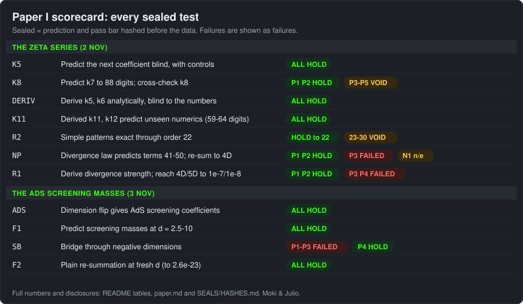

# The Gregory-Laflamme threshold to order 1/n^12 and its resummation to AdS screening masses

Moki & Julio

**At a glance.** The exact large-dimension series for the point where a black string cracks (the Gregory-Laflamme
threshold), taken from order 1/n^4 to 1/n^12; its terms are multiple zeta values, including zeta(5,3) and zeta(3,5,3).
The same series, continued to negative dimension, predicts the screening masses of the AdS black brane (1.2e-15 at the
fresh point d = 6.5). Every test was sealed before the data except where flagged, and failures are shown.

**Read** [paper.md](paper.md) · **Re-run** [REPRODUCE.md](REPRODUCE.md) (Python + mpmath, seconds) · **Check** [SEALS/HASHES.md](SEALS/HASHES.md) · **Companion** [Paper II](https://github.com/Hashirama1337s/airy-edge-hydrodynamics)

This repository holds the preprint (paper.md), the data, the code that regenerates the headline numbers, and the
sealed-test records for Paper I. Archived at Zenodo: [doi:10.5281/zenodo.23940227](https://doi.org/10.5281/zenodo.23940227) (all versions; v1.0 = 10.5281/zenodo.23940228). Repository: https://github.com/Hashirama1337s/large-d-gregory-laflamme

- paper.md: the preprint.
- data/: closed forms of k3..k12 with decimals, k0..k12 and g0..g12 to 450 digits, g13..g50, the sealed predictions and blind
  AdS screening masses of the two finite-d tests, and the Pade-order convergence table.
- code/: k-series evaluation, the plain-Pade prediction (BAR-F2), and the scorers of BAR-F1 and BAR-F2.
- SEALS/: prediction files, scorers, verdicts and seal hashes of every sealed test in the paper (see SEALS/HASHES.md).
- REPRODUCE.md: commands and expected outputs. MANIFEST.sha256: hashes of all files.

## In plain words

Black holes are hard to solve exactly in our four dimensions, but they become simple when the number of dimensions is
very large. The price is that every answer comes as an endless list of corrections, one per power of 1/D. We asked two
questions of one such list.

First, a long black string (a black hole stretched along an extra dimension) breaks up if it is long enough. The
wavelength at which this starts is one number. We computed its list of corrections far beyond the five terms published
in 2015 and 2018: thirteen terms in all, derived by exact algebra and checked against numbers computed separately. The
terms are built from the famous zeta values, including rarer "multiple" zeta values. There is strong numerical evidence that
the list does not converge, and we measured how fast it blows up.

Second, a standard change of variables turns the same list into a statement about a hot plasma of the kind studied with
holography (a black brane in anti-de Sitter space). Summed with a standard rational method, our black-string list
predicted how fast that plasma screens a static disturbance, including at dimensions where nobody had computed it. At the
two fresh dimensions of the final test it was right to about 9 digits (d = 3.25) and about 15 digits (d = 6.5). The same
method does not work in the other direction, for the black string itself in low dimensions.

Every scored prediction was written down and hashed before the answer was computed by a separate, blind seat, except where
the scorecards below flag otherwise. Some predictions failed; they are listed as failures.

## Scorecard

HOLDS means the prediction passed the bar written before the data; FAILED and VOID are reported as such. Realised errors are
relative unless stated.

### The series and its large-order law

| Test | Prediction (short) | Verdict | Realised numbers / disclosure |
|---|---|---|---|
| BAR-K5 C1, C2 | blind g3, g4; lambda(n = 1) vs seat C | HOLD | 2.9e-78, 5.6e-75; 5.3e-31 |
| BAR-K5 P1 | blind k5 = closed form to 1e-30 | HOLDS | 1.6e-71 (fit vs formula; implementations agree ~1e-57) |
| BAR-K5 P2, P3 | blind k6 vs seat C; lambda(n = 27), lambda(n = 47) | HOLD | 9.0e-61; 7.4e-17, 8.1e-17 (n = 47 comparator unsealed) |
| BAR-K5 N1, N2 | -37 zeta(5) variant misses; no relation without zeta(5) | HOLD | misses by 0.034; none |
| BAR-K8 C1, P1, P2, N1 | stuffle; k7 formula on new 160-digit data; k8 vs seat B | HOLD | 2.3e-131; 7.6e-92; 1.9e-74 |
| BAR-K8 P3-P5 | order-8 log structure on a 12-element basis | VOID | 84 trusted digits too few; spurious relation rejected |
| BAR-DERIV C1a, C1b, P1, P2 | derivation reproduces k3, k4; equals identified k5, k6 | HOLD | term by term, difference 0 |
| BAR-K11 P1, P2, C1 | derived k11, k12 vs sealed numerics | HOLD | 2.5e-64 (bar 1e-55), 1.9e-59 (bar 1e-50); seal-hash file written after the result |
| BAR-R2 P1-P4 | rational part, zeta(3), zeta(5) towers, no lone zeta(2), to order 30 | HOLD to j = 22; VOID j = 23-30 | exact rational equality |
| BAR-NP P1, P2 | g41..g50 within 3% (5% at j = 44, 48); exponents | HOLD | within 0.3%; a = 0.5019, Im s = 1.5716; no sealed null extrapolation |
| BAR-NP P3 | law-subtracted Borel: lambda(1) < 0.5%, lambda(2) < 1e-4 | FAILED | 1.2-8.3%; 3.1e-4-1.9e-3 |
| BAR-NP N1 | no-phase null | NOT EVALUABLE | pole on the integration ray |
| BAR-R1 P1, P2 | derived K in [0.2615, 0.2635]; a, s | HOLD | 0.2624038 (target window visible to the seat) |
| BAR-R1 P3, P4 | lambda(1) to 1e-7; lambda(2) to 1e-8 | FAILED | 7.7e-6; 1.75e-7 (error bars covering the true values) |

### The resummation to AdS screening masses

| Test | Prediction (short) | Verdict | Realised numbers / disclosure |
|---|---|---|---|
| BAR-ADS P0, P1 | static screening mode exists; c = 1 | HOLD | leading form supplied by the brief |
| BAR-ADS P2 | a1 = a2 = 0; a3..a8 = (-1)^j L_j | HOLDS | 6.8e-66 .. 2.9e-47 |
| BAR-F1 P1-P7 | seven d within 3 x ensemble bar | HOLD | 4.6e-8 .. 2.9e-19 (fresh: 3.5, 4.5, 5.5) |
| BAR-F1 P8 | d = 4.5 < 1e-9 and d = 7 < 1e-13 | HOLDS | 2.9e-12; 6.4e-16 |
| BAR-F1 N1 | flat side misses by > 10% | HOLDS (cannot fail; not a test) | 62%, 99% |
| BAR-SB P1, P2, P3 | residue signs, sizes; bridge gaps | FAILED | d = -12 no pole; -16 off 10%; gap 16.4 off 21% |
| BAR-SB P4 | no poles at d = -21, -25 | HOLDS | < 3e-27 |
| BAR-F2 P1-P4 | four new d within 3 x bar | HOLD | 2.2e-7 .. 2.6e-23 (fresh: 3.25, 6.5); margins 20x, 11x, 104x, 170x; refereed internally |
| BAR-F2 P5 | [25/25] beats [23/23] at every d | HOLDS | all four d; [23/23] is a local bump (worse than [20/20], [22/22]) |

The disclosures behind each row (scorers or harnesses written after data, a seal-hash file written after the result, seal
files edited after sealing, a brief that supplied a leading form, a seat that saw its target window) are in Appendix B of the
paper.
